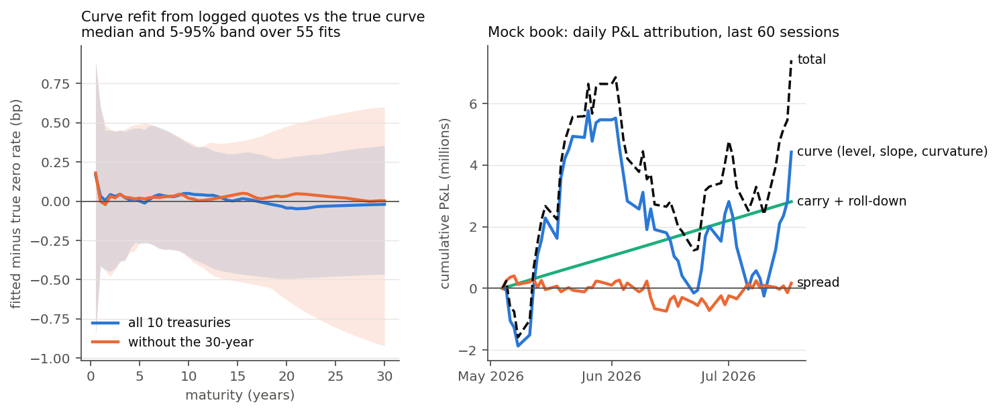

# bond-market-lab

[](https://github.com/JonasLin2005/bond-market-lab/actions/workflows/tests.yml)

A simulated interbank bond market and the tooling a rates and credit desk builds around one:
a client for a rate-limited market-data API, a quote logger that writes to SQLite, SQL
analytics on the log, a Nelson–Siegel curve refit, new-issue pricing off comparables, and a
daily position and P&L sheet with attribution.

Because the market is simulated, the true curve and the true spreads behind every quote are
known. So every estimate the tools produce can be scored against the truth, which you can't
do with real data.

<p align="center"></p>

Left: 55 curve refits from logged treasury quotes, each compared with the true zero curve at
that minute. The median error stays within 0.2 bp at every maturity; dropping the 30-year
bond leaves the median in place but widens the long-end band from about ±0.4 bp to ±0.9 bp.
Right: the mock book over its last 60 sessions. Carry accrues steadily and the curve drives
the swings.

## What's in it

| Module | What it does |
|---|---|
| `curve.py`, `bonds.py` | Nelson–Siegel zero curve; fixed-coupon bonds with accrued interest, price ↔ yield, modified duration, convexity, DV01, curve pricing. Vectorised over time, so a day of quotes prices in one call. |
| `market.py` | 25 bonds across five sectors: treasuries, policy-bank bonds, local government bonds, urban investment bonds and bank Tier 2 capital bonds. Curve factors follow Ornstein–Uhlenbeck processes on a one-minute trading clock (two sessions a day); each credit sector has its own spread curve and spread factor. Brokers post two-sided quotes with noise, liquidity-dependent bid-offer and some one-sided quotes; trades print at the bid or the offer. |
| `api.py` | Mock market-data API with the limits real vendors impose: 365 days per daily-bar request, one day per minute-bar request, 10 securities per call, a token-bucket rate limit, random transient failures, and a quote endpoint that only returns the quote as it stands now. |
| `client.py` | Works within those limits: splits date ranges and security lists, retries rate limits after the delay the server asks for and transient errors with exponential backoff, and caches windows that are wholly in the past (to disk if asked). |
| `logger.py`, `store.py` | Polls the snapshot endpoint on a fixed grid during sessions and writes each snapshot to SQLite in long format `(poll_time, code, field, value)`; a view pivots it back. Inserts are idempotent. |
| `sql/*.sql` | The analytics, as plain SQL files (below). |
| `fit.py`, `experiment.py` | Curve refit (τ by grid search, then all four parameters by least squares on duration-weighted price errors) and the validation experiment. |
| `newissue.py` | Prices a new bond: z-spreads of the sector's quoted bonds over the fitted curve, a spread term structure across them, an issuer adjustment, a new-issue concession and a bookbuilding range. |
| `pnl.py` | Marks the book every session, refits the curve to the marks and splits each position's P&L into carry, roll-down, level, slope, curvature and spread. Exports to Excel. |

## Quick start

```bash
pip install -e ".[dev]"

bondlab demo                       # simulate, pull 540 sessions of daily bars, log 5 days of quotes -> lab.sqlite
bondlab query spread_by_tenor      # any file in bondlab/sql/
bondlab query curve_snapshot --at "2026-07-24 15:00:00"
bondlab refit                      # refit through the log and score against the true curve
bondlab newissue --sector urban_invest --tenor 3 --issuer "City E Urban Development Group"
bondlab pnl --xlsx pnl.xlsx        # position and P&L sheet: Daily P&L, Positions, By sector
python scripts/make_figure.py      # the figure above and the tables below
```

`bondlab demo` takes about half a minute. The database records the seed, so every later
command rebuilds the same market and can compare its answers with the truth.

## Working within the API's limits

The simulated clock (`SimClock`) makes waiting free, so a whole day of polling runs in seconds
while rate limits and backoff still behave as they would in real time.

- **Span caps.** 540 sessions of daily bars for 25 bonds need 3 security batches × 3 date
  windows, so 9 requests. Minute bars go one business day per request, skipping weekends.
- **Rate limits and failures.** At 5 calls a second and a 2% failure rate, the default demo
  makes about 6,000 calls and needs about 100 retries. Tests check that no two successful
  calls ever land less than the allowed interval apart.
- **Caching.** A window that ends before today is cached; one that reaches today is not,
  since today's bar is still changing. A rerun costs one request per security batch.
- **Snapshot-only quotes.** The quote endpoint has no history, so the logger is the only way
  to get an intraday record. Quotes carry their own timestamps, and polls record how old
  each quote was when it was seen.

## SQL

All analytics live in `bondlab/sql/` and run on the log directly:

| Query | What it shows |
|---|---|
| `spread_by_tenor` | Average, min and max bid-offer width by sector and maturity bucket, each quote counted once however many polls saw it |
| `ohlc_1min` | One-minute OHLC of the polled mid yield; open and close from `ROW_NUMBER()` windows |
| `quote_staleness` | How old the live quote was at each poll; share of polls with a stale quote |
| `largest_moves` | Biggest poll-to-poll mid moves, with `LAG()` |
| `curve_snapshot` | The refit input: latest fresh two-sided quote per bond at a given time. Pivots only the polls inside the age window, so it stays fast as the log grows (about 3 ms on 630,000 rows) |
| `eod_marks` | End-of-day mark per bond per session, carried forward when a bond did not trade and flagged as stale |
| `daily_moves` | Day-on-day closing-yield changes from the daily bars |
| `pnl_by_sector` | The P&L sheet summed by sector |

Every query is checked against the same calculation done in pandas.

## Results (default demo, seed 7)

**Curve refit.** 55 check times over five logged sessions, every 30 minutes, skipping the
first half hour after each open, when the latest quotes still date from before the break.
The table gives the RMSE of the fitted minus the true zero rate, in bp.

| input | bonds | fit residual | short (<2y) | belly (2–10y) | long (10–30y) | worst |
|---|---|---|---|---|---|---|
| true fair yields | 10 | 0.00 | 0.00 | 0.00 | 0.00 | 0.00 |
| logged mid quotes | 10 | 0.23 | 0.41 | 0.24 | 0.24 | 1.62 |
| quotes without the 30-year | 9 | 0.23 | 0.41 | 0.24 | 0.37 | 1.56 |

Fitting the exact fair yields recovers the curve to machine precision, which checks the
fitter. On quotes, the error follows the quote noise (0.3 bp on the mid) and the quotes'
age. The short end is worst, since it has the fewest bonds and the largest curve moves.

**New issues.** Priced at 15:00 on the last session. The true fair yield is the par yield
on the true curve plus the issuer's true spread.

| sector | issuer | tenor | comparables | fair yield % | true % | error (bp) |
|---|---|---|---|---|---|---|
| treasury | Treasury | 10 | 0 | 2.188 | 2.183 | +0.5 |
| policy bank | Policy Bank A | 5 | 5 | 2.084 | 2.078 | +0.6 |
| local government | Province A | 7 | 4 | 2.315 | 2.301 | +1.3 |
| local government | Province B | 15 | 4 | 2.553 | 2.535 | +1.8 |
| urban investment | City E Urban Development Group | 3 | 4 | 2.978 | 2.996 | −1.8 |
| urban investment | County F Construction Investment | 5 | 4 | 4.388 | 4.367 | +2.1 |
| Tier 2 | Bank H | 5 | 2 | 2.663 | 2.699 | −3.6 |
| urban investment | *first-time issuer* | 5 | 4 | 3.832 | 3.616 | +21.6 |

With the issuer's own bonds among the comparables, the estimate lands within 4 bp. Without
them it can only use the sector line, and urban investment issuers differ by more than a
hundred basis points, so the error is an order of magnitude larger. Pricing a debut
issuer needs information the quotes don't contain.

**P&L attribution.** The mock book is long local government, policy-bank, urban investment
and Tier 2 bonds and a 30-year treasury, and short the 10-year treasury as a partial hedge.
Over 60 sessions:

| thousands | carry | roll-down | level | slope | curvature | spread | total |
|---|---|---|---|---|---|---|---|
| fitted daily curves | 2,608 | 203 | 3,989 | −1,551 | 1,982 | 169 | 7,400 |
| true curves | 2,608 | 201 | 3,606 | −1,627 | 2,329 | 282 | 7,400 |

Swapping in the true curves leaves the total unchanged and moves P&L between components.
Day by day, the curve P&L from the fitted curves has a correlation of 0.996 with the true
one. The decay parameter is estimated on the first day and then held fixed, as in Diebold
and Li (2006). With it free, day-to-day noise in the decay shifts P&L between level, slope
and curvature in large offsetting amounts. The unexplained column reconciles to within 1e-9.

## Conventions and simplifications

- Continuously compounded zero rates; yields to maturity compounded at the coupon frequency,
  with a fractional first period; ACT/365F for discounting; accrual linear within the period.
- Bonds issue on roll dates, so there are no odd first coupons.
- Tier 2 bonds are treated as bullets to their first call date.
- End-of-day marks use the last two-sided mid before the close, which is steadier than the
  last trade.
- All issuers, codes and prices are fictional. Nothing here comes from a real market.

## Tests

```bash
pytest -q        # 54 tests, about 20 seconds
```

Pricing identities against finite differences and hand sums; price ↔ yield round trips; the
market's quotes, trades and bars against each other; every API limit; chunked pulls against a
single unrestricted pull; retries, rate limiting and both caches; each SQL query against pandas;
the refit on exact data; new-issue pricing against the truth; P&L reconciliation; and the CLI
end to end. CI runs them on Python 3.9, 3.11 and 3.12.

## Background

I built this after a month-long internship at a bank's treasury desks, split between credit
trading and quantitative trading. It rebuilds the kind of work I saw there on a simulated
market, from the data plumbing to pricing and P&L. No code, data or documents from the
internship are used.

## License

MIT
